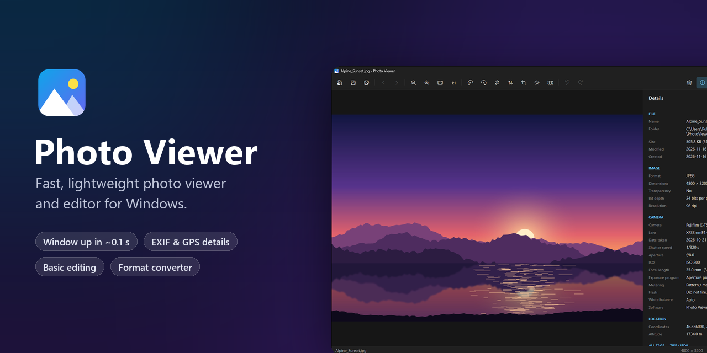
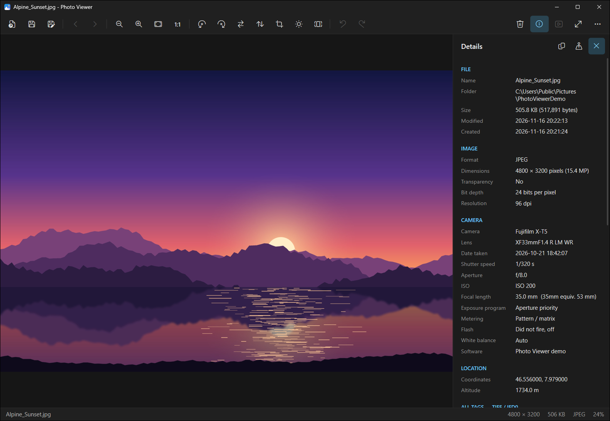
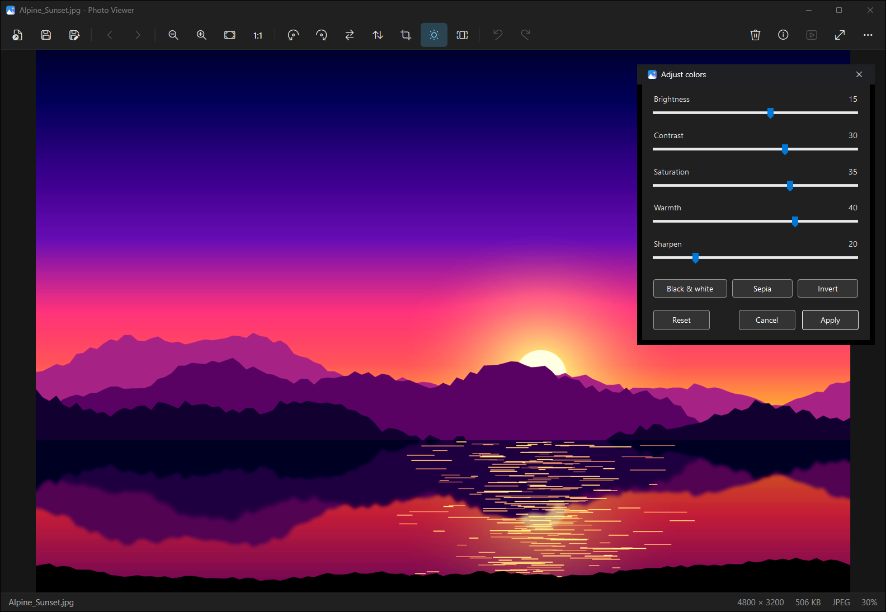
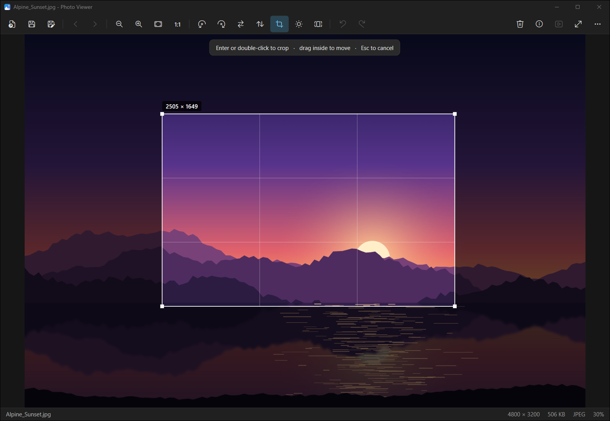

  

  
  &nbsp;
  

  
  
  
  

  🌐 <a href="https://abdullah-al-faahim.github.io/photo-viewer/"><b>abdullah-al-faahim.github.io/photo-viewer</b></a>

  <b>Free on the Microsoft Store</b>, or as one tiny portable .exe. No runtime, no telemetry. 
  Opens your photos fast, shows every bit of EXIF, and does the quick edits you actually need.

---

## Why Photo Viewer?

|  |  |
|---|---|
| ⚡ **Fast** | Native C++ with GPU rendering. The window is up in about 0.1 s and a typical photo is on screen in about 0.15–0.3 s. The next and previous photos are preloaded, so browsing a folder feels instant. |
| 🪶 **Light** | A single ~0.5 MB executable with no dependencies. It uses ~40 MB of RAM while viewing a photo. |
| 🖼️ **Opens almost everything** | JPEG, PNG, GIF (animated), BMP, TIFF, ICO, JPEG XR, DDS, TGA, PPM/PGM. HEIC/HEIF, AVIF, WebP, JPEG XL and **camera RAW** (CR2, CR3, NEF, ARW, DNG, RAF, ORF, RW2…) also open when the free Microsoft Store extensions are installed. |
| 🔍 **EXIF inspector** | Camera, lens, shutter, aperture, ISO, focal length, flash and white balance at a glance. A GPS location button opens the map. Every EXIF / GPS / XMP / IPTC tag is listed, and one click copies them all. |
| ✏️ **Quick edits** | Rotate, flip, crop, resize, and adjust brightness, contrast, saturation, warmth and sharpness with a live preview. Also black & white, sepia and invert, with full undo/redo. |
| 💾 **Safe saving** | Saves as JPEG, PNG, BMP, TIFF, GIF, JPEG XR or HEIC. When you re-save a JPEG, its camera data and GPS are kept. Files are written atomically, so a crash can't corrupt your photo. |

## Screenshots

  

<table>
  <tr>
    <td width="50%"></td>
    <td width="50%"></td>
  </tr>
  <tr>
    <td align="center">Adjust colors with live preview</td>
    <td align="center">Crop with rule-of-thirds guides</td>
  </tr>
</table>

## Install

### Microsoft Store (recommended)

**[Get Photo Viewer (Super-Fast) from Microsoft](https://apps.microsoft.com/detail/9NKZZG22X8TW?referrer=appbadge&mode=direct)** and click **Install**.
Microsoft signs the Store version, so there's no security warning. It updates automatically and shows up under *Open with* for all supported photo types.

### Portable

1. **[Download `PhotoViewer-win-x64.zip`](https://github.com/abdullah-al-faahim/photo-viewer/releases/latest/download/PhotoViewer-win-x64.zip)** from the latest release.
2. Extract it anywhere you like, for example `C:\Apps\PhotoViewer`, and run **`PhotoViewer.exe`**.

> [!NOTE]
> The portable exe isn't code-signed, so Windows SmartScreen may say *"Windows protected your PC"* the first time.
> Click **More info → Run anyway**, or use the Microsoft Store version instead. You can check the download against the SHA-256 checksum on the release page.

*(Optional, either version)* To make it your default viewer, open **⋯ → Set as default photo viewer…**. Then pick Photo Viewer in the Windows Settings page that opens.

**Want HEIC, AVIF, WebP or RAW?** Install the free Microsoft extensions: *HEIF Image Extensions*, *AV1 Video Extension*, *WebP Image Extensions* and *Raw Image Extension*. Photo Viewer picks them up automatically.

**Requirements:** Windows 10 (version 1809) or 11, 64-bit.

## Keyboard shortcuts

| Keys | Action |
|---|---|
| `←` `→` · `PgUp` `PgDn` · `Space` · `Home` `End` | Previous / next / first / last photo |
| Mouse wheel · `+` `−` · `0` · `1` | Zoom · fit to window · 100% |
| `F11` or double-click · `F5` · `I` | Full screen · slideshow · details & EXIF |
| `R` / `L` · `H` / `V` · `C` · `E` · `Ctrl+R` | Rotate · flip · crop · adjust colors · resize |
| `Ctrl+Z` · `Ctrl+Y` | Undo · redo |
| `Ctrl+O` · `Ctrl+S` · `Ctrl+Shift+S` | Open · save · save as |
| `Ctrl+C` · `Ctrl+Shift+C` · `Del` | Copy image · copy details · move to Recycle Bin |
| `Esc` | Cancel crop / leave full screen / close |

Mouse back/forward buttons also go to the previous and next photo. Right-click anywhere for the full menu.

## FAQ

<b>Does it upload or track anything?</b>

No. It works entirely offline. The only network action is the optional **Open location in map** button, which opens OpenStreetMap in your browser when you click it.

<b>Where are settings stored?</b>

Window size and the details-panel state are stored in `HKCU\Software\FastPhotoViewer`. "Set as default" registers file types for your account only (no admin rights needed).

<b>How do I uninstall it?</b>

**Store version:** Settings → Apps → Installed apps → Photo Viewer (Super-Fast) → Uninstall.
**Portable version:** delete the folder. If you used "Set as default", first pick another default app in Windows Settings. Then you can delete `HKCU\Software\FastPhotoViewer` and `HKCU\Software\Classes\FastPhotoViewer.Image`.

## Feedback

Found a bug or have an idea? [Open an issue](https://github.com/abdullah-al-faahim/photo-viewer/issues).

© 2026 abdullah-al-faahim. All rights reserved.

